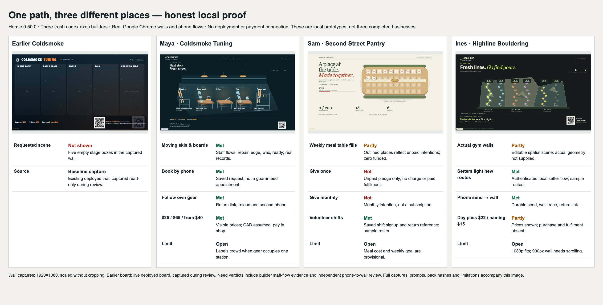

# Three fresh AI trials — Homie 0.50.0



The new path produced three distinct, record-driven places rather than a board of boxes. It did **not** complete every requested business need. Paid giving, paid gym fulfilment, and Highline's actual geometry remain missing. The verdicts below retain those failures.

## How these were made

Three independent `codex exec` processes started concurrently in separate empty temporary folders, using the inherited default `gpt-6-astra` model at medium reasoning. They had no parent conversation or implementation briefing. Each user prompt began with `Read https://homie.rocks/business.md` (Sam: `nonprofits.md`), gave the person's request, and said to decide, keep going, stay offline and show it locally. Exact prompts and the environmental developer instruction are preserved here in the prompt files and `trials.json`.

The environmental instruction routed the public guide's toolkit command to an unpublished npm pack, supplied the real Chrome path and read-only example studios, and asked for captures. It was not literally a user-prompt-only environment: this routing was necessary to test an unpublished build. Command shape:

```sh
codex exec --skip-git-repo-check --dangerously-bypass-approvals-and-sandbox \
  -C "$EMPTY_TRIAL_FOLDER" -c developer_instructions="$ROUTING_INSTRUCTION" \
  -o "$FINAL_NOTE" "$OWNER_PROMPT"
```

Fresh authoring used the 0.50.0 pack from `d5e861fc`, SHA256 `5573aa90035aafa61fb78720eac98505c40e768b044407d7382970f767fc916c`. Trial findings then improved app style context, readable/stale Codex status, acceptance opt-in compatibility and paid-fulfilment guidance. All three existing outputs were installed with the final review pack from `07a43d38`, SHA256 `b5b8f12782e7ade8d172c0b5a1b6eb4b1c273c422d0ab02fa0a776efdd7abeec`, before independent Chrome review. This is **not** a claim that three fresh AIs generated again after those refinements. No app source was hand-rewritten by the reviewer. No output failed the distinct-place/no-box-board condition requiring a new generation.

Each trial retains the review pack at `.trial/toolkit.tgz`; full builder transcripts/final notes remain there privately because staff-session links can occur in them. Session identifiers and transcript hashes are in `trials.json`. The published proof contains captures and review receipts, not authentication material.

`review-flows.mjs` independently opens actual Google Chrome, a 1920×1080 wall and a 390×844 phone, submits through the UI, captures receipts, reloads and follows return links in a new browser context. It is phone viewport emulation, not a physical handset. Builder staff-flow captures are separately labelled; their authenticated local test sessions are not a test of a production owner's passkey enrollment. The original builder dev processes ended with their sessions; the reviewer restarted them locally. No deploy, external message, real payment or paid media generation occurred.

## Maya — Coldsmoke Tuning

| Requested need | Verdict | Real evidence |
|---|---|---|
| Boards and skis move through wax, edge and base repair | Met locally | [Wall](maya/wall.png), [edge](maya/wall-edge.png), [wax](maya/wall-wax.png), [staff](maya/staff.png), [builder flow](maya/flows.json). Durable records drive gear positions. |
| Book a tune from a phone | Met as a request | [Phone receipt](maya/phone-receipt.png), [independent flow](maya/review-flow.json). Requested date, not a capacity-guaranteed appointment. |
| Watch their own gear | Met | [Ready gear](maya/phone-ready.png), [edge](maya/phone-edge.png), [second phone](maya/phone-followed.png). Builder also closed browsers and restarted the server before following the same gear. |
| Basic wax $25, full tune $65, base repair from $40 | Met | [Wall](maya/wall.png), [shop preview](maya/shop.png). CAD assumed; repair estimate confirmed in shop. |
| Show locally, do not put online | Met | Local port 8893; no deployment. |

Limits: payment in shop; no capacity scheduling; conceptual shop layout; overlapping labels when several gear records occupy a station. The independent form entry concatenated the prefilled nickname with the review nickname, visible in the capture rather than retouched. Staff movement was shown separately because the automatic public needs flow cannot authenticate staff. Its aggregate check correctly remains false rather than claiming that coverage. [Builder verdict](maya/builder-verdict.md).

## Sam — Second Street Pantry

| Requested need | Verdict | Real evidence |
|---|---|---|
| Hall screen's weekly meal table fills as neighbours give | Partly | [Wall](sam/wall.png), [before](sam/wall-before.png). Outlined places reflect unpaid intentions; funded meals correctly remain zero. |
| Give once from phone | Not | [Flow receipt](sam/review-flow.json), [shop](sam/shop.png). Saves an unpaid pledge, not a gift payment. |
| Give monthly from phone | Not | [Flow receipt](sam/review-flow.json). Monthly intention only; no subscription or recurring paid event fulfilment. |
| Volunteers sign up for shifts | Met locally | [Receipt](sam/phone-receipt.png), [second phone](sam/phone-followed.png). Durable signup and reference; sample shift roster. |
| Show locally, do not put online | Met | Local port 8896; no deployment. |

Limits: $5 per meal, 200 meals and CAD are provisional assumptions; no payment provider; the trial also omitted an app paid-to-meal handler. The final app guide now explicitly requires the offer's fulfilment and a local paid-event test even when its provider is disconnected. That stronger guidance has not been proven by a fourth fresh builder in this release. No wall QR scan was proved. [Builder verdict](sam/builder-verdict.md).

## Ines — Highline Bouldering

| Requested need | Verdict | Real evidence |
|---|---|---|
| Wall screen of the gym's actual walls | Partly | [Wall](ines/wall.png). Original editable wall geometry, explicitly provisional; actual floor plan/photos were absent. |
| This week's routes light as setters finish | Met locally | [Before](ines/wall-before-setter.png), [after](ines/wall-after-setter.png), [staff](ines/staff.png), [builder flow](ines/builder-flow.json). Authenticated local staff opened a sample route. |
| Log a send by phone and see it on the wall | Met locally | [Receipt](ines/phone-receipt.png), [wall](ines/wall.png), [independent flow](ines/review-flow.json). Durable send and highlighted route; second-phone return. |
| Day pass $22 | Partly | [Shop](ines/shop.png), wall and phone show price; purchase/admission fulfilment absent. |
| “Name a route” $15 | Partly | [Shop](ines/shop.png). Price preview; paid naming fulfilment absent. |
| Show locally, do not put online | Met | Local port 8833; no deployment. |

Limits: actual walls/routes require real reference material; CAD assumed; no live payments; no admission redemption or paid route naming. 1080p wall fits; the 900px-tall review needed vertical scrolling. [Builder verdict](ines/builder-verdict.md).

## Release behavior evidence

The payment-reference regression was committed and run failing before implementation (`da894651`: expected booking reference, received undefined). It now covers the app reference and order id arriving in `order.paid`, omitted/invalid references, duplicate webhook delivery and reopened payment links. The reference is correlation supplied by a buyer, not authorization; fulfilment must verify the record, app, amount and currency and deduplicate the order.

App tests exercise planning before plumbing, plan preservation, shared page rendering/status, app style selection, opt-in compatibility, actual needs steps and failures. The real Chrome app release gate proves both a met need and an unbuilt need causing `ok:false`, with wall/phone captures. Existing game behavior remains covered. No new default studio caps or policies were added.

## Retained folders

- Maya: `/var/folders/63/1sbmhrlj05g9gvcghc49h8q80000gn/T/homie-050-maya-_mrhvk1a` — studio `coldsmoke`, http://127.0.0.1:8893/workshop/tv?room=shop
- Sam: `/var/folders/63/1sbmhrlj05g9gvcghc49h8q80000gn/T/homie-050-sam-bhnajm4m` — studio `pantry`, http://127.0.0.1:8896/gathering/tv?room=pantry
- Ines: `/var/folders/63/1sbmhrlj05g9gvcghc49h8q80000gn/T/homie-050-ines-x374al1a` — studio `highline`, http://127.0.0.1:8833/climb/tv?room=highline

These are the three retained trial studios. Review server PIDs are recorded in `trials.json`; other people's processes and read-only example studios were not changed.
